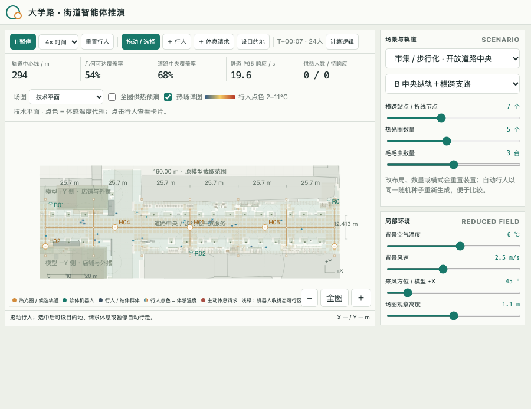

# 大学路街道智能体

大学路微气候与街道智能体交互推演。在线页面使用 `index.html`（自包含，不依赖 `app.js`、外部 CDN 或本机服务）。

**在线页面：** https://liuxingtong.github.io/daxuelu/

> 如果仓库是 private，GitHub Pages 需要 GitHub Pro/团队计划；免费账号请把仓库设为 public，或改用其他静态托管。



## 内容

| 路径 | 说明 |
|---|---|
| `index.html` | 部署到 GitHub Pages 的紧凑网页版 |
| `output/street-agent-lab/` | 完整源码、测试、设计说明 |
| `街道智能体_四维筛选_合并版_v2026.10.08/` | 前期案例筛选参考页 |
| `.github/workflows/pages.yml` | GitHub Pages 自动部署 |

## 本地运行与重建

```bash
cd output/street-agent-lab
python3 build.py          # 完整版 index.html
python3 build_embed.py    # 紧凑版 index-embed.html
node --test tests/*.test.mjs
```

根目录的 `index.html` 由 `output/street-agent-lab/index-embed.html` 复制而来。完整版运行说明、参数和公式见 [`output/street-agent-lab/README.md`](output/street-agent-lab/README.md)。

## 飞书个人文档

飞书个人文档不会执行上传的 `.html` 附件；妙笔BOX / 妙搭 HTML 应用也会落到企业租户。个人文档里若需分享，请使用 GitHub Pages 链接，或把网页截图放进文档。

## 未提交的大文件

- `2601008_大学路_图层整理版.3dm`（约 264 MB，保留在本机）
- `output/imagegen/`（生成图片与 prompt，保留在本机）

页面本身不依赖这些文件。
